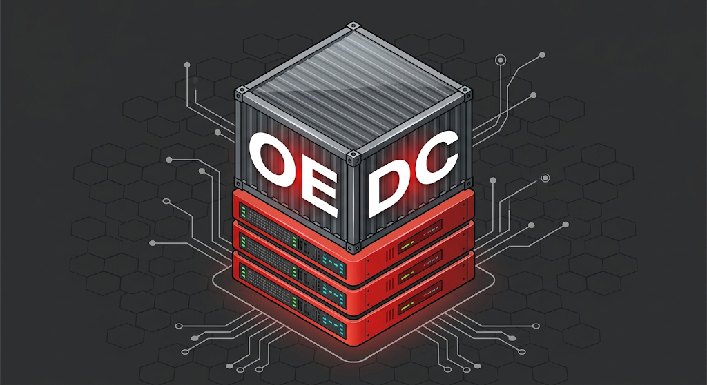

[](https://github.com/ZouariOmar/dot-files/graphs/contributors)
[](https://github.com/ZouariOmar/dot-files/network/members)
[](https://github.com/ZouariOmar/dot-files/stargazers)
[](https://github.com/ZouariOmar/dot-files/issues)
[](LICENSE)
[](https://www.linkedin.com/in/zouari-omar)

<h1 align="center">
  <a href="https://github.com/zouari-oss/oedc"></a>
  OEDC
</h1>

<h4 align="center">Oracle Enterprise Database Container</h4>

<p align="center">
  <a href="#"></a>
  <a href="#"></a>
</p>

- [Features](#features)
- [Requirements](#requirements)
- [Quickstart](#quickstart)
- [Emailware](#emailware)
- [License](#license)
- [Contact](#contact)
- [Acknowledgments](#acknowledgments)

## Features

- **Oracle Database Enterprise Edition** — runs the official image from Oracle's container registry (`container-registry.oracle.com/database/enterprise:latest`), so you get a full EE instance without a local install.
- **Fixed container identity** — `container_name: oracle-db` and `hostname: oracle-host` keep the container predictable for scripts, JDBC URLs, and links from other services on the same network.
- **Credentials kept out of the compose file** — all sensitive values (`ORACLE_SID`, `ORACLE_PDB`, `ORACLE_PWD`, `ORACLE_CHARACTERSET`) are read from a `.env` file rather than hardcoded.
- **Configurable SID, PDB, and character set** — the CDB name, pluggable database name, and database character set are all set at first startup via environment variables.
- **Persistent data** — the named volume `oracle_data` is mounted at `/opt/oracle/oradata`, so datafiles survive `docker compose down` and container recreation.
- **Host timezone alignment** — `/etc/localtime` is mounted read-only so database timestamps match the host clock.
- **Automatic initialization** — any `*.sql` or `*.sh` files placed in `./init-script` are mounted to `/opt/oracle/scripts/startup` and executed on container start, letting you create schemas, users, and seed data automatically.
- **Network isolation by default** — the `1521:1521` port mapping is commented out, so the database is reachable only from other containers on the compose network; uncomment it when you need host access.

> [!NOTE]
> Startup scripts run on _every_ container start, not just the first — make them idempotent. Because `oracle_data` persists, changing `ORACLE_PWD` or `ORACLE_SID` > later has no effect unless the volume is removed; the database is only created once.

## Requirements

- [Git](https://github.com/git/git)
- [Docker](https://github.com/docker)

## Quickstart

Clone & go into repository

```bash
git clone https://github.com/zouari-oss/oedc && cd oedc
```

Setup `.env` file

```bash
cp .example.env .env
```

Start the container

```bash
docker compose up
```

## Emailware

OEDC is an [emailware](https://en.wiktionary.org/wiki/emailware). Meaning, if you liked using this repository or it has helped you in any way, I'd like you to send me an email at <zouariomar20@gmail.com> about anything you'd want to say about this repository. I'd really appreciate it!

## License

This repository is licensed under the **GPL License**. You are free to use, modify, and distribute the content. See the [LICENSE](LICENSE) file for details.

## Contact

For questions or suggestions, feel free to reach out:

- **GitHub**: [ZouariOmar](https://github.com/ZouariOmar)
- **Email**: [zouariomar20@gmail.com](mailto:zouariomar20@gmail.com)
- **LinkedIn**: [Zouari Omar](https://www.linkedin.com/in/zouari-omar)

## Acknowledgments

Built with ❤️ for the open-source community.
